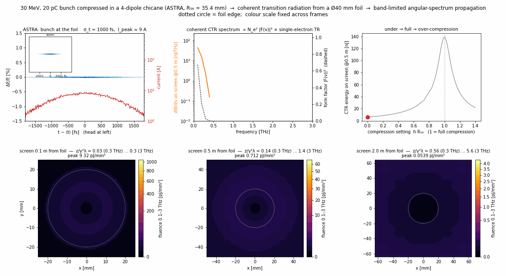
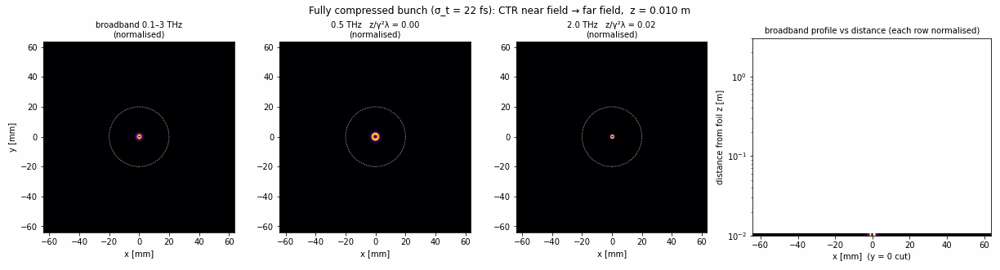

# ctr-nearfield-asm

Simulation of **bunch compression → coherent transition radiation (CTR) → near-field THz images**, built on ASTRA particle tracking and a band-limited angular spectrum method (ASM).



```
ASTRA chicane tracking ──► bunch at foil (x_j, y_j, t_j) ──► coherent CTR source field ──► band-limited ASM ──► screens
     beamline.py               make_gif.bunch_at_foil             ctr.py                     asm.py
```

A 30 MeV, 20 pC bunch is compressed in a four-dipole chicane, from 1 ps to 22 fs rms. Its coherent CTR from a Ø40 mm foil is then propagated through the THz near field (γ²λ = 0.36–3.6 m).



## External codes (not included)
This repository does **not** contain or redistribute third-party codes. Install them from their official sources:

| code | used for | where to get it |
|---|---|---|
| **ASTRA** (K. Flöttmann, DESY) | chicane tracking (`beamline.py`, `run_scan.py`) | https://www.desy.de/~mpyflo/. Set the path in `beamline.py` (`ASTRA = ...`) |
| **SRW** (O. Chubar et al.) | dipole edge-radiation source and cross-checks only (`srw_source.py`, `validate_*.py`) | https://github.com/ochubar/SRW, or `pip install srwpy` |

Neither code is needed to run `example_from_distribution.py`. ASTRA is only needed to re-track the beam, and SRW only for the cross-checks.

## Contents
| file | what it does |
|---|---|
| `beamline.py` | Beam and chicane parameters, ASTRA input writer and runner, particle bookkeeping |
| `run_scan.py` | 32-point chirp scan (h·R56 = 0 → 1.4), 8 ASTRA runs in parallel |
| `ctr.py` | Ginzburg–Frank foil field built in k-space, cloud-in-cell deposit of the complex macro-particle density, coherent convolution, foil aperture |
| `asm.py` | Angular-spectrum propagator (exact k_z, evanescent waves dropped, zero padding, Matsushima–Shimobaba band limit) |
| `make_gif.py` | Builds the two GIFs in `media/` |
| `example_from_distribution.py` | Quick start: a CTR screen image from one shipped distribution (no ASTRA needed) |
| `validate_ctr.py` | ASM vs semi-analytic Fresnel–Hankel integral vs SRW drift propagator (`media/validation_ctr_asm.png`) |
| `srw_source.py`, `validate_asm.py` | SRW edge and synchrotron radiation from the last dipole, with ASM cross-check (`media/validation_asm_vs_srw.png`) |
| `calibration_bias.py` | Gaussian-calibration bias study: 36 Gaussian calibration bunches and 32 ASTRA bunches pass through the same forward model, giving image FWHM and rms radius on 5 screens |
| `calibration_analysis.py` | Inverts the Gaussian calibration, compares with rms / FWHM / form-factor σ, joint multi-screen fit, sensitivity (`media/calibration/`) |
| `distributions/` | ASTRA particle distributions, see below |

## Particle distribution files
`distributions/` holds ASTRA-format phase-space files (100 000 macro-particles, gzipped) for four of the 32 chirp settings, together with the ASTRA input deck used for each:

| tag | h·R56 | σ_t at chicane exit | files |
|---|---|---|---|
| `h000p000` | 0.00 | 1000 fs (uncompressed) | `.in`, `.ini.gz` (input), `.0345.001.gz` (z = 3.45 m) |
| `h014p847` | 0.53 | 475 fs | same |
| `h028p281` | 1.00 | 22 fs (full compression) | same |
| `h039p593` | 1.40 | 403 fs (over-compressed) | same |

The columns follow the ASTRA convention: x, y, z [m], px, py, pz [eV/c], t [ns], q [nC], species, status. The first line is the reference particle; on the other lines z and pz are given relative to it. `numpy.loadtxt` reads the `.gz` files directly. To re-track with ASTRA, unzip the `.ini.gz` next to its `.in` deck and run `astra <tag>.in`.

## Quick start
```bash
pip install -r requirements.txt
python example_from_distribution.py distributions/h028p281.0345.001.gz --z 0.5   # no ASTRA needed
python validate_ctr.py                                                          # ASM validation
python run_scan.py && python make_gif.py --prop                                  # full study (needs ASTRA; ~15 min, ~750 MB output)
python calibration_bias.py && python calibration_analysis.py                     # calibration-bias study (after run_scan.py; ~12 min)
```

## Validation
For a single electron behind the foil, the band-limited ASM agrees with a semi-analytic Fresnel–Hankel integral to within 0.1–3 % of peak, for 0.3–2.5 THz and z/γ²λ = 0.03–4.7. Two corrections are essential:
1. The source kernel is built analytically in k-space (`Ẽ(q) ∝ q/(q² + (k/βγ)²)`). Sampling the 1/r core of K₁ in real space puts the peak about 15 % low at 2.5 THz.
2. The Matsushima–Shimobaba band limit. Without it, transfer-function aliasing gives errors of up to ~40 % at long z and low frequency.

## Gaussian-calibration bias (`media/calibration/`)
A CTR-image monitor calibrated with Gaussian bunches was applied to the 32 non-Gaussian ASTRA bunches (0.1–3 THz band):
* The inferred σ equals the σ of the best-fit Gaussian form factor to within 3 %. The image encodes |F(ν)| only.
* It underestimates the rms duration by ≤ 8 % (4 % at full compression). For ωσ ≪ 1, |F|² ≈ 1 − ω²σ²_rms for any profile.
* Converting it to a FWHM with the Gaussian factor 2.355 overestimates the true FWHM by up to ~2× near full compression (spike plus tail).
* Images at 5 distances fit a single Gaussian to < 1 %, so multiple planes cannot reveal the profile shape.
* Sensitivity collapses below ~50 fs (a 10 % σ_t measurement needs 1.5 % width precision at 50 fs and 0.27 % at 20 fs). A screen 0.1 m from the foil is 2–3.5× more sensitive than one at 0.5–1 m.

## Assumptions and limitations
* No space charge or CSR in the chicane, which is idealised for the fully compressed bunch.
* The foil is an ideal conductor, treated at normal incidence. Each electron's field is translated to its (x_j, y_j). The electrons' angular spread is neglected.
* The scalar ASM is applied to E_x and E_y separately, and E_z is neglected (angles ≲ 0.1 rad).
* Macro-particle shot noise gives |F|² ≈ 1/N_macro. Spectrum points below 20/N_macro are masked.
* SRW near-field edge radiation is not used as the ASM source: its terminating terms fail at low THz, and it includes the electron's Coulomb self-field. See `validate_asm.py`.

## License
Released under a license adapted from the [RENEW Open Source License](https://github.com/renew-wireless/RENEWLab/blob/master/LICENSE): a BSD-style license with a citation condition. See [LICENSE](LICENSE). Any publication that uses this software or the distribution files must cite it as given in [CITATION.cff](CITATION.cff).

## How to cite
Please cite this repository (use the "Cite this repository" button, or `CITATION.cff`). Also cite the tools and methods it builds on:

* **ASTRA**: K. Flöttmann, *ASTRA – A Space Charge Tracking Algorithm*, DESY, https://www.desy.de/~mpyflo/
* **SRW**: O. Chubar, P. Elleaume, "Accurate and efficient computation of synchrotron radiation in the near field region", Proc. EPAC'98, pp. 1177–1179; https://github.com/ochubar/SRW
* **Band-limited ASM**: K. Matsushima, T. Shimobaba, Opt. Express 17 (2009) 19662, doi:10.1364/OE.17.019662
* **Fourier optics**: J. W. Goodman, *Introduction to Fourier Optics*, 3rd ed. (2005)
* **Transition radiation**: V. L. Ginzburg, I. M. Frank, J. Phys. USSR 9 (1945) 353; V. A. Verzilov, Phys. Lett. A 273 (2000) 135; S. Casalbuoni et al., Phys. Rev. ST Accel. Beams 12 (2009) 030705
* **Coherent-radiation bunch diagnostics**: R. Lai, A. J. Sievers, Nucl. Instrum. Methods A 397 (1997) 221
* **Python stack**: NumPy (Harris et al., Nature 585 (2020) 357), SciPy (Virtanen et al., Nat. Methods 17 (2020) 261), Matplotlib (Hunter, CiSE 9 (2007) 90), imageio
