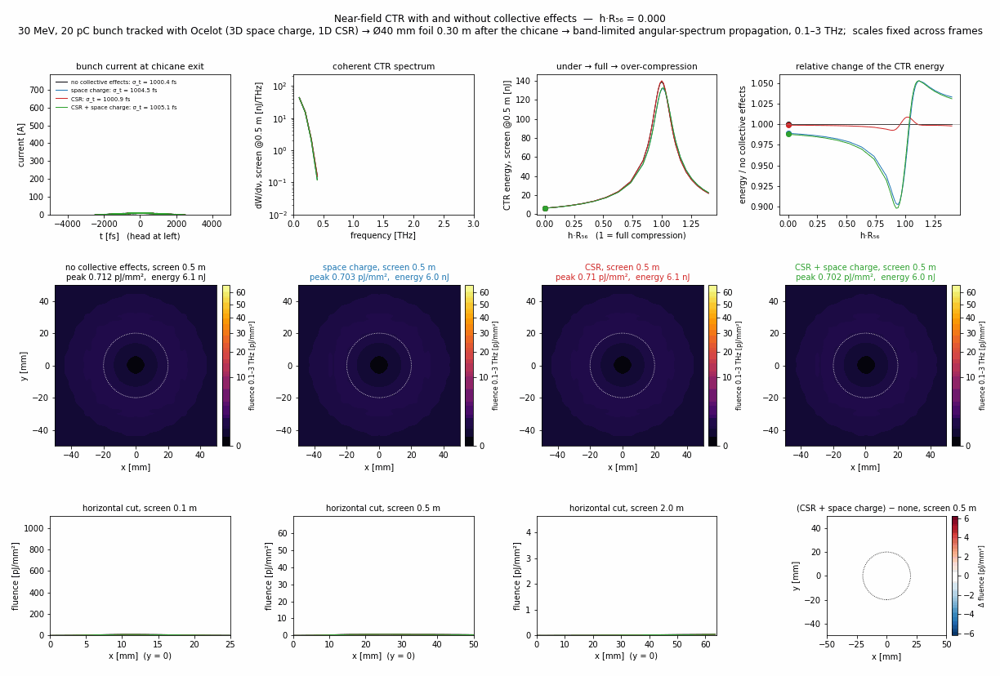

# CSR and space charge in the chicane (Ocelot)

The main study tracks the chicane with ASTRA without collective effects. This folder repeats the same chirp scan
with [Ocelot](https://github.com/ocelot-collab/ocelot), adding space charge and coherent synchrotron radiation (CSR)
to show how they change the compressed bunch. Beam, chicane and initial distributions are imported from
`../beamline.py` and the scan from `../run_scan.py`, so the bunches entering the chicane are identical to the ASTRA
ones (same seed).

| mode | collective effects |
|---|---|
| `none` | none (lattice check against ASTRA) |
| `sc` | 3D space charge (`SpaceCharge`, 63³ mesh, kick every 5 mm) |
| `csr` | 1D projected CSR (`CSR`, steady state + entrance/exit transients, 300 bins) |
| `both` | space charge + CSR |

| file | what it does |
|---|---|
| `track.py` | Ocelot lattice and tracking in the four modes → `collective/results/<tag>_<mode>.ast` (ASTRA format) |
| `analysis.py` | Bunch length, FWHM, peak current, projected emittance (dispersion removed), energy loss, beam size → `collective/results/figs/` |
| `checks.py` | Ocelot R56; bunch length versus ASTRA without collective effects; space-charge convergence |
| `ctr_gif.py` | Near-field CTR for the four modes (same foil, source and ASM as `../make_gif.py`) → `media/collective/` |

## Running
From the repository root:
```bash
pip install ocelot-collab
python collective/track.py none,csr,sc,both    # 128 runs, ~15-20 min on 8 cores
python collective/analysis.py                  # scan.pdf, profiles.pdf, numbers.txt
python collective/checks.py                    # checks.txt (ASTRA comparison skipped if ASTRA is not installed)
python collective/ctr_gif.py                   # CTR for all modes, media/collective/*.gif (~10 min)
```
`python collective/track.py both 0.94,1.0,1.06` tracks selected h·R56 settings only. The output files have the same
format as the ASTRA ones, so they can be passed to the CTR/ASM code in the main folder (e.g.
`example_from_distribution.py`). Set `OMP_NUM_THREADS=1` when running several processes in parallel.

## Model
In Ocelot each rectangular dipole is an `SBend` with edge angles 0 and ±θ; the drifts between dipoles 1–2 and 3–4
have path length 1 m / cos θ. Tracking uses second-order maps (`SecondTM`), so T566 is included. Distributions are
exchanged in ASTRA format through `astraBeam2particleArray` / `particleArray2astraBeam`. CSR uses
`sigma_min = 0.2 µm`; Ocelot's default (100 µm) would smooth away the CSR of the compressed bunch.

## Results (`collective/results/figs/numbers.txt`)
| mode | min rms σ_t | at h·R56 | peak current | ε_n,x | max mean energy loss |
|---|---|---|---|---|---|
| none | 21.8 fs | 1.000 | 509 A | 0.995 µm | – |
| space charge | 23.6 fs | 1.015 | 512 A | 1.34 µm | – |
| CSR | 19.7 fs | 1.000 | 549 A | 1.02 µm | 26.5 keV |
| both | 21.6 fs | 1.015 | 548 A | 1.34 µm | 26.1 keV |

At 30 MeV and 20 pC the effects on the bunch length are small (≲ 10 %). Space charge mainly grows the
transverse beam (projected emittance +35 % at full compression) and moves the minimum to slightly stronger chirp.
CSR costs ≈ 0.1 % of the beam energy and slightly sharpens the current spike.

## Near-field CTR (`media/collective/`)


Each frame is one chirp setting: current profiles, CTR spectra and energy on the 0.5 m screen for the four modes,
the 0.5 m screen images on a common colour scale, cuts through the 0.1, 0.5 and 2.0 m screens, and the difference
image (CSR + space charge − none). The CTR energy keeps its 23-fold rise over the scan; its maximum drops by 5 %
(139 → 133 nJ) and moves to h·R56 = 1.015 with space charge. The largest changes, −10 % at h·R56 ≈ 0.93 and +5 %
at ≈ 1.1, follow from this shift. CSR alone changes the energy by < 1 %. The ring images keep their shape and radius
(`ctr_numbers.txt`, `ctr_energy.pdf`).

## Checks
* Ocelot gives |R56| = 35.38 mm; ASTRA gives 35.36 mm.
* Without collective effects the rms bunch length agrees with ASTRA to within 0.3 % over the scan
  (1000.4 / 1000.4 fs at h·R56 = 0, 21.8 / 21.8 fs at full compression, 402 / 403 fs at h·R56 = 1.4).
* Space charge at full compression is converged: a 95³ mesh or a 2.5 mm kick step changes the bunch length by
  < 0.5 % and the emittance by < 1 %.

## Limitations
* CSR is 1D (projected). At full compression the Derbenev parameter (σ_x/σ_z)·√(σ_x/ρ) is about 1, so the 1D
  model is marginal there and probably overestimates CSR.
* No CSR shielding by the vacuum chamber.
* Tracking ends 5 cm after the last dipole, as in the ASTRA runs. The initial bunch is the ideal chirped Gaussian
  of `beamline.py`; space charge upstream of the chicane (e.g. in a low-energy injector) is not included.

## References
* I. Agapov, G. Geloni, S. Tomin, I. Zagorodnov, "OCELOT: A software framework for synchrotron light source and FEL
  studies", Nucl. Instrum. Methods A 768 (2014) 151, doi:10.1016/j.nima.2014.09.057
* E. L. Saldin, E. A. Schneidmiller, M. V. Yurkov, "On the coherent radiation of an electron bunch moving in an arc
  of a circle", Nucl. Instrum. Methods A 398 (1997) 373, doi:10.1016/S0168-9002(97)00822-X
* Ya. S. Derbenev, J. Rossbach, E. L. Saldin, V. D. Shiltsev, "Microbunch radiative tail-head interaction",
  TESLA-FEL 95-05 (1995)

Ocelot is distributed separately under its own license (GPL-3.0) and is not included here.
